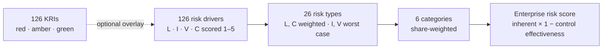

# Enterprise Risk Assessment (ERA) Model

A bottom-up enterprise risk model for a bank: **126 risk drivers** roll up into **26 risk types**, **6 risk
categories** and one **enterprise risk score**, with a key risk indicator (KRI) monitoring every driver. It ships
as an interactive Streamlit dashboard, a command-line runner and an Excel input template that anyone can edit.

> Author: **Emmanuel C. Iheme**, Insight Analytics & Risk Profiling Analyst · Basel III · CBN Risk-Based Supervision · COSO ERM · ISO 31000
>
> *Sample Bank Plc is fictional and all scores and KRI values are synthetic. The model shows a framework and its engineering, not any institution's risk profile.*

---

## Results on the sample bank

| Measure | Value |
|---|---|
| Enterprise risk score (residual, 1–25) | **7.47 · Low** |
| Enterprise inherent score | 17.34 |
| Enterprise control effectiveness | 57% |
| Highest category | Technology & Cyber Risk, 8.96 (Medium) |
| Largest share of residual risk | Financial Risk, 30% |
| Highest risk type | Cyber Risk, 11.95 (Medium) |
| KRIs | 44 red · 46 amber · 36 green |
| With the KRI overlay on | 8.16 · Medium |

## How it works



At every level: **inherent = likelihood × impact** and **residual = inherent × (1 − control effectiveness)**,
on a 1–25 scale banded **Low ≤ 8, Medium ≤ 15, High > 15**. Full formulas, scales and design choices are in
[`docs/METHODOLOGY.md`](docs/METHODOLOGY.md).

## Dashboard

| Tab | What it shows |
|---|---|
| Enterprise | ERA score on the 0–25 scale, inherent vs residual by category, each category's share of residual risk |
| Risk types | All 26 ranked by residual, plus a drill-down into any risk type's drivers, controls and KRIs |
| Drivers and KRIs | KRI status by category, a 5×5 driver risk matrix, and a filterable table of all 126 drivers |
| What-if | Edit any driver's scores and watch the risk type, category and enterprise scores move |
| Methodology | The formulas and scales |
| Excel v1.0 reconciliation | How and why the corrected model differs from the original workbook |

The sidebar changes the assumptions live: worst case or weighted aggregation, the KRI overlay, risk-level
thresholds, control effectiveness by score and category weights. Results download as an Excel workbook.

## Quick start

```bash
git clone https://github.com/emmanueliheme/enterprise-risk-assessment.git
cd enterprise-risk-assessment
pip install -r requirements.txt

streamlit run app.py              # dashboard
python run_era.py                 # CLI → outputs/era_results.xlsx
python run_era.py --kri-overlay   # with KRI adjustment
pytest -q                         # 25 tests
```

### Use your own data

Download the template from the app's sidebar (or open `data/era_inputs.xlsx`), edit the blue columns and upload
it. The app checks the workbook first and lists anything to fix: weights that don't sum correctly, scores outside
1–5, unknown risk types or reversed KRI thresholds.

| Sheet | One row per | Key columns |
|---|---|---|
| Categories | risk category | `category`, `weight` (sums to 100%) |
| RiskTypes | risk type | `risk_type_id`, `category`, `risk_type`, `enterprise_weight`, `definition` |
| Drivers | risk driver | `driver_id`, `risk_type_id`, `weight` (sums to 1 per type), `likelihood`, `impact`, `velocity`, `control_score`, `kri_name`, `kri_actual`, `amber_threshold`, `red_threshold`, `kri_direction` |

### Use as a library

```python
from era import ModelConfig, load_inputs, run
from era import reporting

res = run(load_inputs("data/era_inputs.xlsx"), ModelConfig(kri_overlay=True, medium_max=14))
res.enterprise["era"], res.enterprise["level"]
reporting.category_table(res)
open("results.xlsx", "wb").write(reporting.export_excel(res))
```

## From Excel to Python

Version 1.0 was an Excel workbook. Rebuilding it in code exposed calculation errors that a reviewer would catch:
risk-type likelihoods were typed in rather than linked to the drivers, categories were weighted by their own
scores, four different threshold sets were in use, and 40 KRIs were rated in the wrong direction. The fixes are
listed in the methodology, and the reconciliation tab shows the effect on every risk type: the enterprise score
moves from 11.50 (Medium) to 7.47 (Low) once the drivers actually drive the result.

## Project structure

```
era/
  config.py      scales, thresholds, control effectiveness, KRI overlay: every assumption
  data.py        workbook loading and validation
  model.py       driver → risk type → category → enterprise scoring
  reporting.py   tables, reconciliation and Excel export
app.py           Streamlit dashboard
run_era.py       command-line runner
data/            sample inputs (fictional) and v1.0 results for reconciliation
docs/            methodology
tests/           model and app tests
```

## Limitations

The scores are expert judgements on a 1–5 scale, so the model is only as good as the assessment behind it.
A production version would add assessment history and trend, sign-off workflow, links from KRIs to loss events,
and calibration of the control effectiveness table against control testing results.

## Licence

MIT
